### Hola 👋

Soy Oscar Garay, especialista en ciberseguridad. Trabajo en respuesta a incidentes y análisis forense digital (DFIR), y en mi tiempo libre desarrollo herramientas gratuitas y en español para análisis forense y respuesta a incidentes.

*Cybersecurity specialist working in incident response and digital forensics. In my spare time I build free forensic tools in Spanish.*

### 🔍 Herramientas

<table>
  <tr>
    <td width="96" align="center"></td>
    <td>
      <b><a href="https://github.com/navestigio/navestigio">Navestigio</a></b> · forense de navegadores 
      Analiza el historial, las descargas, las cookies y las credenciales de Chrome, Edge y Firefox en una sola página que funciona sin internet. La evidencia no sale del equipo y no se modifica. 
      <a href="https://navestigio.github.io/navestigio/">Página del proyecto</a> · <a href="https://github.com/navestigio/navestigio/releases/latest">Descargar</a>
    </td>
  </tr>
</table>

### 🛠️ Con qué trabajo

`DFIR` · `Respuesta a Incidentes` · `Análisis Forense` ·`Análisis de Malware` · `SQLite` · `Python` · `JavaScript` · 

### 💚 Apoya mis herramientas

Son gratuitas y las desarrollo en mi tiempo libre. Si te ahorran horas en tus casos, tu apoyo me ayuda a dedicarles más tiempo. ¡Gracias!

  
  
  

Licencias comerciales y contacto: <a href="mailto:oscargarayacosta@pm.me">oscargarayacosta@pm.me</a>
